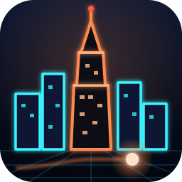
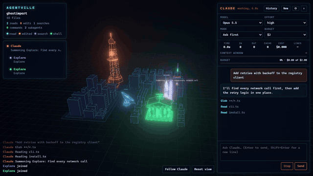
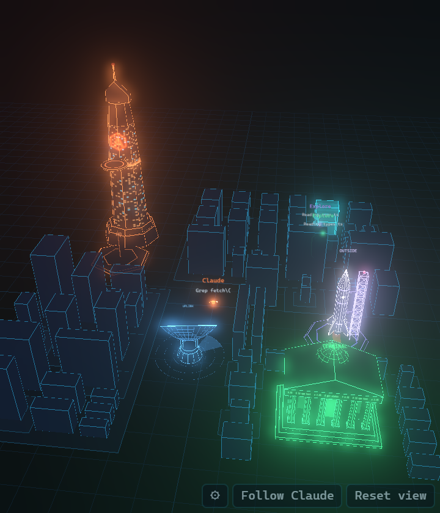

  

<h1 align="center">Agentville</h1>

  <b>Watch Claude Code work inside a 3D city built from your code.</b> 
  A VS Code extension. <i>Coming soon.</i>  
  <a href="https://fguerreir0.github.io/agentville/">Website</a> ·
  <a href="#install">Install</a> ·
  <a href="#help">Help</a>

  

Your folders become districts and your files become buildings. While Claude Code works,
you see it walk to each file it reads, light up each file it edits, and run commands at the
bank. Subagents get their own colored orbs. When Claude needs your permission, it turns
amber with a **!**, so you never miss it.

  🌐 <b><a href="https://fguerreir0.github.io/agentville/">See it in action on the website →</a></b>

## Install

> **Coming soon.** Click **Watch → Custom → Releases** on this repo to hear when it's out.

1. Install **Agentville** in VS Code.
2. Click **Install** when it offers to set up its Claude Code plugin.
3. Start Claude Code in the folder you have open. That's it.

You need [Claude Code](https://code.claude.com) and VS Code 1.99 or later.

## What you see

| When Claude… | In the city |
|---|---|
| reads a file | walks to that building, which glows cyan |
| edits a file | sparks on the roof; the building stays amber |
| searches | a violet ring sweeps the folder |
| runs a command | walks to the bank; the command scrolls on its ticker |
| uses the web | walks to the radar dish, which fires |
| starts a subagent | a smaller orb in its own color appears |
| needs your permission | turns amber with a bouncing **!** |

<table>
  <tr>
    <td width="50%"> Subagents walking the streets</td>
    <td width="50%"> Waiting for your permission</td>
  </tr>
</table>

## Choose your view

<table>
  <tr>
    <td width="68%" valign="top"></td>
    <td width="32%" valign="top"></td>
  </tr>
  <tr>
    <td valign="top"><b>Big: an editor tab, with the chat.</b> The city fills a tab beside your code, and you can talk to Claude right there.</td>
    <td valign="top"><b>Small: in the Explorer.</b> A minimap under your folders, for when you run Claude Code in a terminal.</td>
  </tr>
</table>

Switch any time with the **⚙** button in the city, or **Agentville: Switch View** from the
Command Palette. Either way, the city follows Claude Code wherever it runs.

### Chat with Claude, right beside the city

In the big view, Agentville has its own chat panel: pick the model and mode, approve edits
with a diff, and see time, tokens and cost for every run. Click any building to open the file
or ask Claude about it.

The chat runs Claude Code on **your own Anthropic API key**, which you create in the
[Claude Console](https://platform.claude.com/settings/keys); Anthropic bills its usage to
you, separately from any Claude plan. The key stays in your system keychain. The city doesn't
need a key: it follows Claude Code wherever you run it.

**Why an API key and not my Claude plan?** The chat is built on Anthropic's Claude Agent SDK,
and [Anthropic's terms](https://code.claude.com/docs/en/legal-and-compliance) don't allow
third-party products built on it to run on Free, Pro or Max plan logins: they have to use API
keys. Your plan keeps working in Claude Code itself, in the terminal or the Claude Code panel,
and Agentville's city shows those sessions just the same.

### Controls

**Drag** to orbit · **scroll** to zoom · **right-drag** to pan · **click an agent** to follow it.

## Privacy

Your code never leaves your machine. The plugin only talks to VS Code on your own computer,
and only sends file paths and tool names, never file contents or Claude's output. It never
slows Claude down. The plugin is open source: [`plugin/`](plugin/).

## Does it increase my Claude usage?

The city, no: it only listens to events Claude Code already sends and never calls the model.
The chat runs on your own API key, billed by Anthropic per use, with nothing added to your
prompts. It helps you keep that in check: the cost of every run, a budget per conversation,
and Haiku for quick questions.

## Pricing

Free for a week of use, then **€2,99, once**. No subscription.

## Help

**Nothing shows up?** Run **Agentville: Show Log** from the Command Palette: it tells you what
it received and why anything was ignored. Most often the fix is one of these:

- Start Claude Code from the same folder VS Code has open.
- Run **Agentville: Install Claude Code Plugin**, then start a new Claude session.

Still stuck, or have an idea? [Open an issue](https://github.com/FGuerreir0/agentville/issues/new/choose).
More about Agentville on the [website](https://fguerreir0.github.io/agentville/).

## Support

If you enjoy watching your agents at work, you can [buy me a coffee](https://buymeacoffee.com/fabioguerreiro).

---

Agentville is an independent project, not affiliated with or endorsed by Anthropic.
Claude and Claude Code are trademarks of Anthropic.
