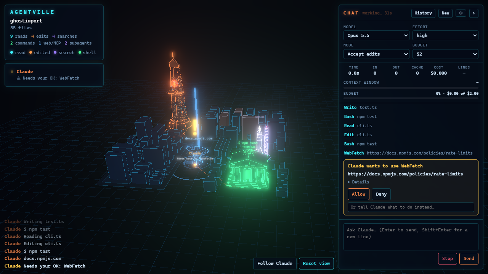

  

<h1 align="center">Agentville</h1>

  <b>Watch Claude Code work inside a 3D city built from your code.</b> 
  A VS Code extension. <i>Coming soon.</i>  
  <a href="https://fguerreir0.github.io/agentville/">Website</a> ·
  <a href="#install">Install</a> ·
  <a href="#help">Help</a>

Your folders become districts and your files become buildings. While Claude Code works,
you see it walk to each file it reads, light up each file it edits, and run commands at the
bank. Subagents get their own colored orbs. When Claude needs your permission, it turns
amber with a **!**, so you never miss it.

  🌐 <b><a href="https://fguerreir0.github.io/agentville/">See it in action on the website →</a></b>

## Install

> **Coming soon.** Click **Watch → Custom → Releases** on this repo to hear when it's out.

1. Install **Agentville** in VS Code.
2. Click **Install** when it offers to set up its Claude Code plugin.
3. Start Claude Code in the folder you have open. That's it.

You need [Claude Code](https://code.claude.com) and VS Code 1.99 or later.
No API key: it uses your existing Claude Code login.

## What you see

| When Claude… | In the city |
|---|---|
| reads a file | walks to that building, which glows cyan |
| edits a file | sparks on the roof; the building stays amber |
| searches | a violet ring sweeps the folder |
| runs a command | walks to the bank; the command scrolls on its ticker |
| uses the web | walks to the radar dish, which fires |
| starts a subagent | a smaller orb in its own color appears |
| needs your permission | turns amber with a bouncing **!** |

<table>
  <tr>
    <td width="50%"> Claude and two subagents reading files</td>
    <td width="50%"> Waiting for your permission</td>
  </tr>
</table>

### Chat with Claude, right beside the city

Agentville has its own chat panel: pick the model and mode, approve edits with a diff, and see
time, tokens, cost and your plan's usage limits for every run. Click any building to open the
file or ask Claude about it.

Prefer the terminal? The city follows Claude Code wherever it runs. You can also shrink it
into the Explorer side bar as a minimap (setting `agentville.view`: `sidebar`).

### Controls

**Drag** to orbit · **scroll** to zoom · **right-drag** to pan · **click an agent** to follow it.

## Privacy

Your code never leaves your machine. The plugin only talks to VS Code on your own computer,
and only sends file paths and tool names, never file contents or Claude's output. It never
slows Claude down. The plugin is open source: [`plugin/`](plugin/).

## Pricing

Free for a week of use, then **€2,99, once**. No subscription.

## Help

**Nothing shows up?** Run **Agentville: Show Log** from the Command Palette: it tells you what
it received and why anything was ignored. Most often the fix is one of these:

- Start Claude Code from the same folder VS Code has open.
- Run **Agentville: Install Claude Code Plugin**, then start a new Claude session.

Still stuck, or have an idea? [Open an issue](https://github.com/FGuerreir0/agentville/issues/new/choose).
More about Agentville on the [website](https://fguerreir0.github.io/agentville/).

---

Agentville is an independent project, not affiliated with or endorsed by Anthropic.
Claude and Claude Code are trademarks of Anthropic.
