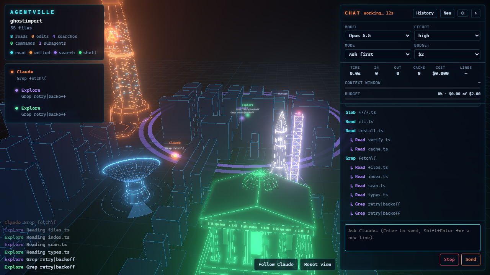
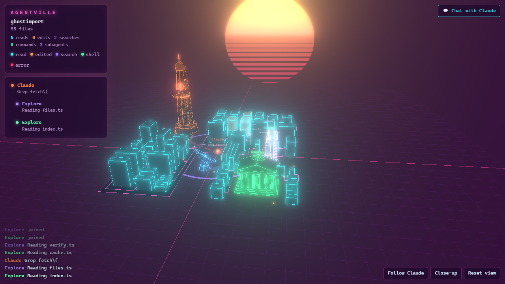
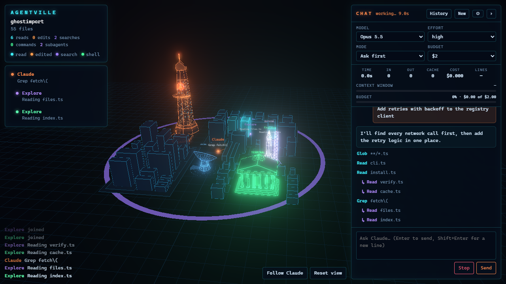

  

<h1 align="center">Agentville</h1>

  <b>Watch Claude Code work inside a 3D city built from your code.</b> 
  For VS Code.  
    
  <a href="https://fguerreir0.github.io/agentville/">Website</a> ·
  <a href="#install">Install</a> ·
  <a href="#help">Help</a>

Your folders become districts and your files become buildings. While Claude Code works,
you see it walk to each file it reads, light up each file it edits, and run commands at the
bank. Subagents get their own colored orbs. When Claude needs your permission, it turns
amber with a **!**, so you never miss it.

  🌐 <b><a href="https://fguerreir0.github.io/agentville/">See it in action on the website →</a></b>

## Install

1. **Install Agentville in VS Code.** The Marketplace listing is on its way. Until then,
   install it from a file:
   1. On [Open VSX](https://open-vsx.org/extension/fguerreir0/agentville), click **Download**
      to get `fguerreir0.agentville-<version>.vsix`.
   2. In VS Code, open the Extensions view (`Ctrl+Shift+X`, or `Cmd+Shift+X` on a Mac), click
      **⋯** at its top, choose **Install from VSIX…**, and pick the file.
   3. Reload the window when VS Code asks.

   Or from a terminal: `code --install-extension fguerreir0.agentville-<version>.vsix`.

     > **Don't double-click the `.vsix`.** On Windows with Visual Studio installed, that opens
     > Visual Studio's installer, which fails with *"One or more extensions are for Visual
     > Studio Code"*. Install it from inside VS Code as above.
2. Click **Install** when it offers to set up its Claude Code plugin.
3. Start Claude Code in the folder you have open. That's it.

You need [Claude Code](https://code.claude.com) and VS Code 1.99 or later.

## What you see

| When Claude… | In the city |
|---|---|
| reads a file | walks to that building, which glows cyan |
| edits a file | sparks on the roof; the building stays amber |
| searches | a violet ring sweeps the folder |
| runs a command | walks to the bank; the command scrolls on its ticker |
| uses the web | walks to the radar dish, which fires |
| starts a subagent | a smaller orb in its own color appears |
| needs your permission | turns amber with a bouncing **!** |
| a file has errors (the Problems panel) | its building throbs red until they're fixed |

<table>
  <tr>
    <td width="50%"> Subagents walking the streets</td>
    <td width="50%"> Waiting for your permission</td>
  </tr>
</table>

### A city that lives

Even when Claude is quiet, the city goes on. Each part has its own switch in the **⚙** menu,
under **City life**:

- **Construction:** a new file's building rises from the ground, a deleted one comes down,
  and buildings grow or shrink as their files do.
- **Git:** a soft light floats over every file with uncommitted changes, a commit sets off
  fireworks over HQ, and the branch name stands on HQ's plaza.
- **Trails:** the streets agents walk most glow, like worn paths, and the districts where they
  spend their time warm up.
- **Traffic:** little lights travel the streets.
- **Lights:** a building stays lit for a couple of minutes after it's read or edited.
- **Day & night:** the sky follows the time of day.

### Themes

Pick a look in the same menu: **Midnight** (deep blue, cyan outlines) or **Miami** (a neon
coast at sunset: purple sky, pink and turquoise glow, a striped sun on the horizon).

## Choose your view

<table>
  <tr>
    <td width="68%" valign="top"></td>
    <td width="32%" valign="top"></td>
  </tr>
  <tr>
    <td valign="top"><b>Big: an editor tab, with the chat.</b> The city fills a tab beside your code, and you can talk to Claude right there.</td>
    <td valign="top"><b>Small: in the Explorer.</b> A minimap under your folders, for when you run Claude Code in a terminal.</td>
  </tr>
</table>

Agentville starts in the Explorer. Switch any time with the **⚙** button in the city (it remembers your choice), or **Agentville: Switch View** from the
Command Palette. Either way, the city follows Claude Code wherever it runs.

### Chat with Claude, right beside the city

In the big view, Agentville has its own chat panel: pick the model and mode, approve edits
with a diff, and see time, tokens and cost for every run. Click any building to open the file
or ask Claude about it.

The chat runs Claude Code on **your own Anthropic API key**, which you create in the
[Claude Console](https://platform.claude.com/settings/keys); Anthropic bills its usage to
you, separately from any Claude plan. The key stays in your system keychain. The city doesn't
need a key: it follows Claude Code wherever you run it.

**Why an API key and not my Claude plan?** The chat is built on Anthropic's Claude Agent SDK,
and [Anthropic's terms](https://code.claude.com/docs/en/legal-and-compliance) don't allow
third-party products built on it to run on Free, Pro or Max plan logins: they have to use API
keys. Your plan keeps working in Claude Code itself, in the terminal or the Claude Code panel,
and Agentville's city shows those sessions just the same.

### Controls

**Drag** to orbit · **scroll** to zoom · **right-drag** to pan · **click an agent** to follow it · **double-click** it to ride along in the close-up, just behind it between the buildings (drag, scroll or Esc to leave) · **Busiest** keeps the camera on whichever agent is doing the most, in the close-up too · the frame icon resets the view.

## Privacy

Your code never leaves your machine. The plugin only talks to VS Code on your own computer,
and only sends file paths and tool names, never file contents or Claude's output. It never
slows Claude down. The plugin is open source: [`plugin/`](plugin/).

## Does it increase my Claude usage?

The city, no: it only listens to events Claude Code already sends and never calls the model.
The chat runs on your own API key, billed by Anthropic per use, with nothing added to your
prompts. It helps you keep that in check: the cost of every run, a budget per conversation,
and Haiku for quick questions.

## Pricing

Free for a week of use, then **€2,99, once**. No subscription.

## Help

**Nothing shows up?** Run **Agentville: Show Log** from the Command Palette: it tells you what
it received and why anything was ignored. Most often the fix is one of these:

- Start Claude Code from the same folder VS Code has open.
- Run **Agentville: Install Claude Code Plugin**, then start a new Claude session.

Still stuck, or have an idea? [Open an issue](https://github.com/FGuerreir0/agentville/issues/new/choose).
More about Agentville on the [website](https://fguerreir0.github.io/agentville/).

## Support

Questions about your license or a purchase: **alcoda.support@gmail.com**. Bugs and ideas:
[open an issue](https://github.com/FGuerreir0/agentville/issues/new/choose).

---

Agentville is an independent project, not affiliated with or endorsed by Anthropic.
Claude and Claude Code are trademarks of Anthropic.
