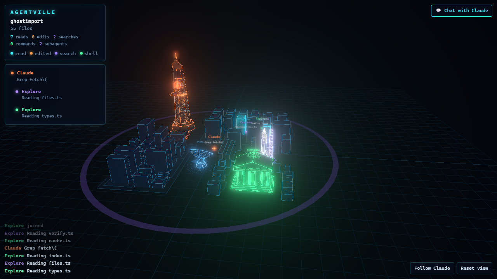
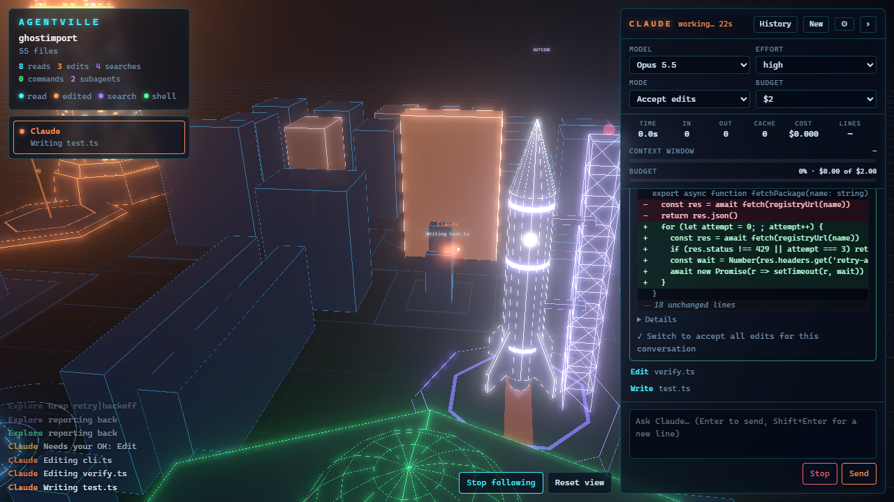
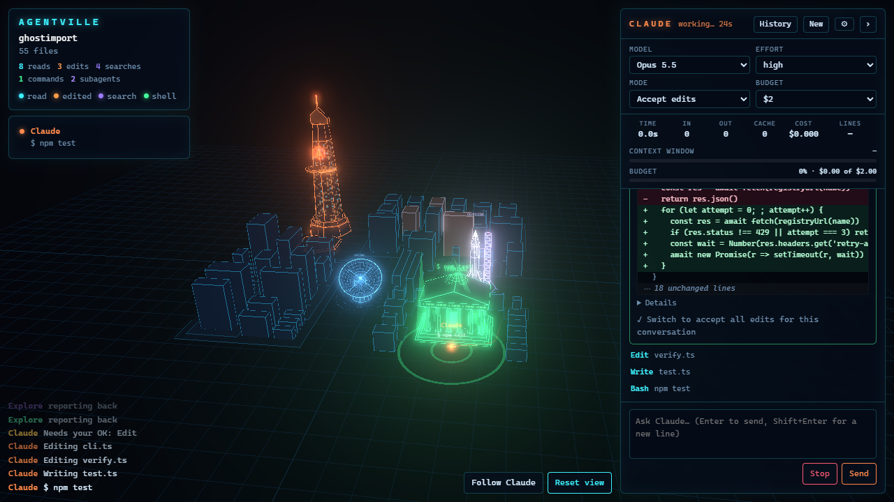
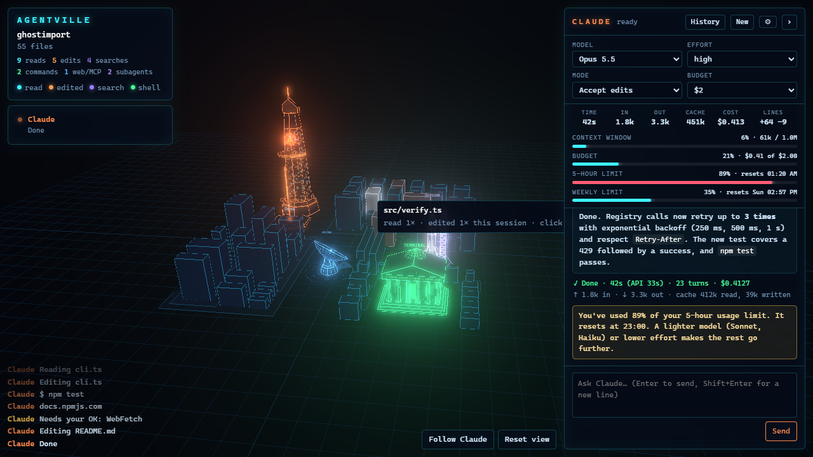
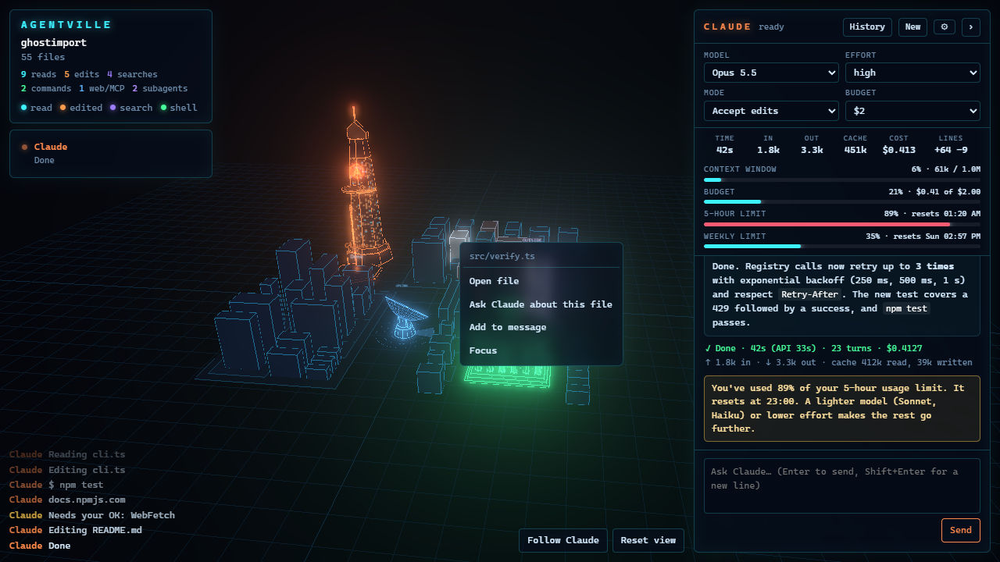
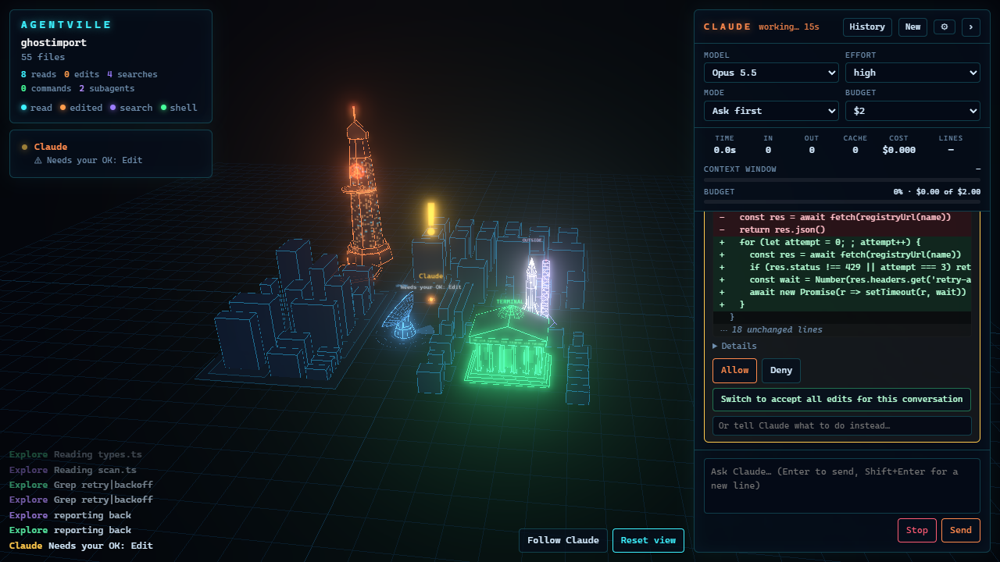

<p align="center">
  
</p>

<h1 align="center">Agentville</h1>

<p align="center">
  <b>Watch Claude Code work inside a 3D city built from your codebase.</b><br>
  A VS Code extension for developers who use Claude Code.<br>
  <i>Coming soon.</i>
</p>

<p align="center">
  <a href="#install">Install</a> ·
  <a href="#what-you-see">What you see</a> ·
  <a href="#chat-with-claude">Chat</a> ·
  <a href="#privacy">Privacy</a> ·
  <a href="#pricing">Pricing</a> ·
  <a href="https://github.com/FGuerreir0/agentville/issues">Report a bug</a>
</p>


Every folder in your workspace becomes a district and every file a building. Claude is a
glowing orb that walks the streets: to a building to read it, to the bank to run a command,
to the radar to reach the web, and home to the tallest tower in town to think. Subagents are
smaller orbs in their own colors that go off on their own errands, then come back to report.

It runs live in a VS Code panel while Claude works, in the terminal, in the Claude Code
extension, or in Agentville's own chat.

- **See what Claude is doing at a glance.** Which files it reads, which it edits, which
  commands it runs, and when it is stuck waiting for you.
- **Follow subagents.** Each one is its own orb, labelled with its type, doing its own work.
- **See what changed.** Edited buildings stay amber, so at the end of a session the whole
  footprint of the change is visible.
- **Chat, permissions and usage in one place.** Pick the model, effort and mode, approve
  edits with a diff, and see time, tokens, cost and plan limits for every run.

> The images come from the built-in preview, which plays a scripted session over the files
> of a real repo ([ghostimport](https://github.com/FGuerreir0/ghostimport), 55 files). With
> the plugin installed, the same scene is driven by Claude Code's real hook events.

---

## Install

> **Coming soon.** Agentville isn't released yet. Watch this repo (**Watch → Custom →
> Releases**) to hear when it is.

1. **Install the extension** from the VS Code Marketplace or from
   [Releases](https://github.com/FGuerreir0/agentville/releases), and reload VS Code.
2. **Click Install** when Agentville offers to install its Claude Code plugin.

That's it. Start a new Claude Code session in the folder VS Code has open (or run
`/reload-plugins` in one), and Claude shows up in the city.

**Requires** VS Code 1.99 or later, [Claude Code](https://code.claude.com), and Node.js 18
or later on the `PATH` (Claude Code already needs it). Works on Windows, macOS and Linux.

<details>
<summary>What the plugin install does</summary>

The plugin ships inside the extension. Agentville copies it to `~/.agentville/claude-plugin`
and installs it with `claude plugin install`, and updates it when a new version of the
extension brings a new plugin. If you dismissed the offer, the city's empty state has an
**Install** button, and **Agentville: Install Claude Code Plugin** is in the Command Palette.

The plugin's source is in this repo, in [`plugin/`](plugin/), so you can read exactly what
it sends. To try it for one session without installing it: `claude --plugin-dir ./plugin`.
</details>

---

## What you see

### The landmarks



Four landmarks stand in the city, one for each kind of work that happens outside your code.

| Landmark | Station | What happens there |
|---|---|---|
| A skyscraper with a landing pad and a glowing crown | **HQ** | Agents start here, come back to think when you send a prompt, and rest when they're done |
| A bank with columns, a dome and a stock ticker | **TERMINAL** | Shell commands. The ticker scrolls the command that just ran |
| A giant radar dish with a sweep circling the ground | **UPLINK** | Web fetches, web searches and MCP tools. The dish fires a beam into the sky |
| A rocket on its launch pad, beside a gantry | **OUTSIDE** | Files outside the workspace. The engines fire and the rocket strains on the pad |

### What Claude does, in the city

| Claude Code does | In the city |
|---|---|
| Starts a session | Claude, an orange orb, appears on the HQ plaza |
| Gets your prompt | Walks back to HQ with your prompt overhead; a ring spins while it thinks |
| `Read` | Walks to the file's building; a cyan scan sweeps it |
| `Edit` / `Write` | An amber ring and sparks on the roof; the building stays warm for the session |
| `Grep` / `Glob` | Goes to the folder's district; a violet ring sweeps it (or the whole city) |
| `Bash` / `PowerShell` | Walks to the bank; the command scrolls across the ticker |
| `WebFetch`, `WebSearch`, MCP tools | Walks to the radar; the dish fires |
| Spawns a subagent | A smaller orb in its own color appears, labelled `Explore`, `Plan`, … |
| A subagent finishes | It walks back to Claude and merges in a burst |
| Needs your permission | Turns amber with a bouncing **!** |
| A tool fails | Flashes red, with "✗ failed" |
| Compacts its context | Its ring whirls and squeezes |
| Finishes | Walks home to HQ and idles |

The orbs don't fly over the roofs: they walk the streets, taking the shortest way around
the buildings. An orb walking behind a building still shows through it as a faint glow.

<table>
  <tr>
    <td width="50%"><br><sub><b>Subagents at work.</b> Claude greps while two <code>Explore</code> subagents read files in parallel.</sub></td>
    <td width="50%"><br><sub><b>Editing.</b> Edited buildings keep an amber tint for the rest of the session.</sub></td>
  </tr>
  <tr>
    <td><br><sub><b>Running commands.</b> The command scrolls across the bank's ticker.</sub></td>
    <td><br><sub><b>Waiting for you.</b> Amber, with a bouncing <b>!</b>, and the roster says why.</sub></td>
  </tr>
  <tr>
    <td><br><sub><b>The streets.</b> Agents walk the avenues between folders and the alleys between files.</sub></td>
    <td><br><sub><b>Inspect a building.</b> Hover for its path and how often it was read and edited.</sub></td>
  </tr>
</table>

---

## Chat with Claude

The panel beside the city runs Claude Code itself, in the workspace folder, with your
installed `claude` and your existing login. **No API key, nothing extra to sign in to.**
Everything Claude does from the chat plays out in the city.

- **Model, effort, mode, budget.** Switch any of them mid-conversation. Modes: *Ask first*,
  *Accept edits*, *Plan only*, *Auto*, and *⚠ Bypass* (only for a sandbox you can throw away).
- **History.** Lists the conversations in this folder, including ones you had in a terminal
  or the Claude Code panel. Pick one to continue it here.
- **Stop** interrupts the run and calls everyone home.
- **Click a tool line** that names a file or folder, and the camera flies to it.

### The city and the chat, together



**Click a building** to open the file, ask Claude about it, add it to your message, or fly the
camera to it. **Shift+click** buildings or districts to collect several, then ask.

### Permissions



- **Edit and Write show a diff** of what would change. **Bash** shows the full command and
  Claude's description of it.
- **Always-allow buttons** are the rules Claude Code itself suggests, for example
  *Always allow Bash(npm test:\*) in this project*.
- **Deny** can carry a message telling Claude what to do instead.

### Metrics and usage

| Where | What |
|---|---|
| While it runs | A live timer |
| After each run | Wall and API time, turns, cost, and input / output / cache tokens |
| Session row | Totals, plus lines of code added and removed |
| **Context window** bar | How full the conversation's context is |
| **5-hour** / **Weekly limit** bars | How much of your claude.ai plan you've used, and when each window resets |

- **Limit warnings** when your plan's 5-hour or weekly window passes 85%, once per window.
- **Budget** per conversation: Claude Code stops when it is reached.
- **Send with Haiku**: with Opus or Fable selected, a short question can go to Haiku for that
  one message, while the conversation is still short enough for it to save money.

On a subscription, the cost shown is what the same usage would cost at API prices, as Claude
Code reports it.

---

## In the Explorer

Prefer to keep working in a terminal or in the Claude Code panel? Set `agentville.view` to
`sidebar`, and the city moves into the Explorer as a small **Agentville** section under your
folders, like a minimap. Same live city, without the chat. Switch back any time from the
**⚙** menu or **Agentville: Switch View**.

## Controls

- **Drag** to orbit, **scroll** to zoom, **right-drag** to pan.
- **Click an agent**, or its row in the roster, to follow it with the camera.
- **Follow Claude** / **Reset view** buttons at the bottom right.
- After 25 seconds without activity, the camera slowly circles the city.

## Settings

| Setting | Default | |
|---|---|---|
| `agentville.view` | `panel` | `panel`: an editor tab with the chat. `sidebar`: a small section in the Explorer, without the chat |
| `agentville.openOnSessionStart` | `true` | Open the city when a Claude Code session starts in this workspace |
| `agentville.claudePath` | *(empty)* | The `claude` executable the chat runs. Empty: the first one on `PATH` |
| `agentville.chat.budgetUsd` | `0` | Default budget for a chat conversation, in dollars. `0`: none |
| `agentville.usage.warnAt` | `85` | Warn when your plan's 5-hour or weekly limit passes this percent. `0`: never |
| `agentville.maxFiles` | `4000` | Most files turned into buildings. Larger repos are cut off |
| `agentville.camera.autoRotate` | `true` | Slowly circle the city after 25 seconds without activity |
| `agentville.effects.bloom` | `true` | The glow around lit edges. Off is lighter on slow machines |

`node_modules`, `.git`, `dist`, `build`, `out`, `.next`, `coverage`, virtual envs and similar
folders are never turned into buildings.

---

## How it works

```
Claude Code ──hook events──▶ plugin (emit.mjs) ──HTTP, 127.0.0.1──▶ VS Code extension ──▶ 3D city
 (terminal or VS Code)        async, trims payload   per-window token    event server,        three.js
                                                                         workspace scan
```

1. A small **Claude Code plugin** ([`plugin/`](plugin/)) hooks session, prompt, tool,
   permission, subagent and compaction events. Every hook is `async`, so **Claude never waits
   for it**, and it always exits cleanly, whether or not VS Code is open.
2. The **extension** listens on `127.0.0.1` with a random port and token, scans the workspace
   into a city, and ignores sessions from other folders.
3. The **city** turns events into agents walking the streets, with A* paths through a
   squarified-treemap layout of your folders and files.

The chat runs Claude Code through the
[Claude Agent SDK](https://code.claude.com/docs/en/agent-sdk/typescript), using your
installed `claude`, so it uses your login, settings and plugins.

## Privacy

- **Nothing leaves your machine** for the city. The plugin only talks to `127.0.0.1`, and
  only with a token read from your home directory.
- **File contents, tool output and full prompts never leave the hook.** An event carries the
  event name, session and agent ids, tool name, file path, search pattern, a shell command cut
  to 120 characters, the first 80 characters of your prompt, and the host (not the full URL)
  of a web fetch. Read [`plugin/scripts/emit.mjs`](plugin/scripts/emit.mjs) to check.
- The only network call Agentville itself makes is to check a license key with the store,
  when you enter one and now and then after that.

## Pricing

Agentville is **free for a week of use**: seven days on which the city sees Claude at work,
within 30 days of the first. After that, a license key keeps it for **€2,99**, once.
Use **Agentville: Buy Agentville** and **Agentville: Enter License Key** from the Command
Palette, or the buttons in the panel.

---

## Troubleshooting

**Nothing shows up in the city?**

1. Run **Agentville: Show Log** from the Command Palette. It says which folder the window
   listens for, lists every event it receives, and why any was ignored.
2. Check `~/.agentville/hook.log`, one line per hook run:
   - **No lines:** Claude Code isn't running the plugin. Check `/plugin`, or run
     **Agentville: Install Claude Code Plugin**.
   - **Lines ending in `0/0 window(s)`:** no VS Code window with Agentville is open.
   - **Lines with `cwd=` another folder:** start Claude from the folder VS Code has open.
3. **Chat says no `claude` found:** set `agentville.claudePath` to your Claude Code executable.

Still stuck? [Open an issue](https://github.com/FGuerreir0/agentville/issues/new/choose) with
the log.

## Known limitations

- After restarting VS Code the chat starts empty; pick the conversation in **History** to
  continue it.
- The plan-usage bars use an experimental SDK call. If it changes, the bars disappear and
  everything else keeps working.
- `.gitignore` isn't read yet; only the built-in exclude list keeps generated folders out.
- Two VS Code windows on the same folder both show the events.

## Roadmap

- Let Claude point the camera ("show me the auth flow").
- Replay past sessions from their transcripts.
- Approve / Deny buttons on a waiting agent, right in the city.

Ideas and bug reports are welcome in [Issues](https://github.com/FGuerreir0/agentville/issues).

---

<sub>Agentville is an independent project and is not affiliated with or endorsed by
Anthropic. Claude and Claude Code are trademarks of Anthropic.</sub>
